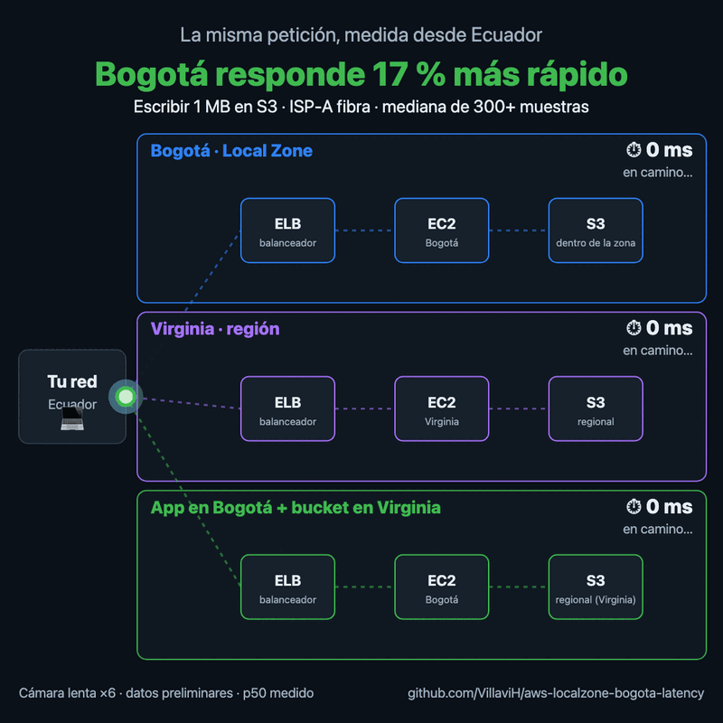
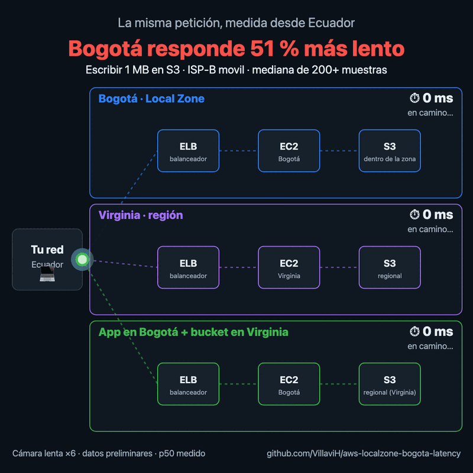
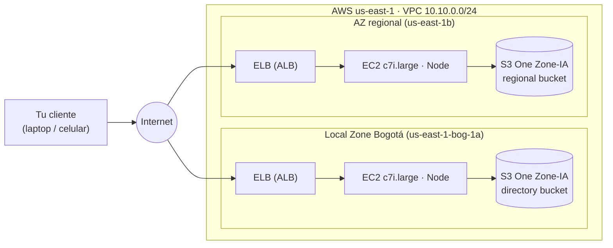
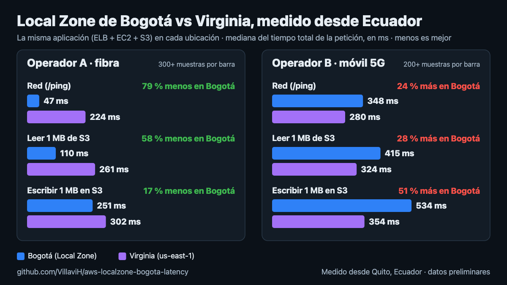

# ¿Vale la pena la Local Zone de AWS en Bogotá para tus usuarios?

[English](README.md)

Una prueba de latencia abierta y reproducible: **AWS Local Zone Bogotá** (`us-east-1-bog-1a`) frente a **us-east-1 (Virginia)**, medida desde *tu* oficina, casa o red móvil. La latencia depende mucho del ISP y de la ruta, así que la única forma de saberlo es medir desde donde están tus usuarios.

<p align="center">


</p>

*La misma petición (escribir 1 MB en S3) en cámara lenta, con las medianas medidas. Izquierda: ISP-A fibra. Derecha: ISP-B móvil 5G. Pruébala en vivo: `demo.html`.*

Las primeras mediciones se hicieron en Ecuador (ISP-A fibra, ISP-B móvil 5G). Los resultados cambian mucho según el ISP; mira `data/raw/` y el dashboard.

## Qué despliega
La misma app pequeña se despliega dos veces, una en la Local Zone de Bogotá y otra en una AZ regional (Virginia), usando solo servicios que AWS lista como disponibles en la Local Zone de Bogotá:
- **ELB:** un Application Load Balancer por ubicación.
- **EC2:** una `c7i.large` por ubicación (el tipo más barato disponible en la zona; no hay t3). Misma app Node.
- **S3 One Zone-IA:** un bucket de directorio dentro de la Local Zone y un bucket regional escrito con la misma clase de almacenamiento en Virginia.
- VPC `10.10.0.0/24` con subredes `/26`. Endpoints: `/ping`, `/payload` (1 MB), `/api/read?obj=small|large` y `/api/write?obj=small|large` (S3), `/health` (sin token). Todo lo demás exige el header `x-probe-token`; sin él responde 403.

## Arquitectura


## Requisitos
- Una cuenta AWS con la **Local Zone de Bogotá activada** (comandos en el README en inglés).
- Terraform >= 1.5, AWS CLI, `curl`, `bash` (en Windows, WSL). Opcional: `mtr`, `k6`.

## Inicio rápido
```
cd infra/terraform
cp terraform.tfvars.example terraform.tfvars   # define tu aws_profile
terraform init && terraform apply
terraform output                                # IPs
export PROBE_TOKEN=$(terraform output -raw probe_token)
cd ../..
./scripts/measure.sh bogota   <IP_BOGOTA>   <ISP> <fibra|movil> 100 2 &
./scripts/measure.sh virginia <IP_VIRGINIA> <ISP> <fibra|movil> 100 2 &
wait
```
Usa el nombre real de tu ISP en lugar de `<ISP>` (por ejemplo `MYISP`), mantenlo igual en todas las corridas, y usa `movil` para celular o hotspot. Para ver la ruta: `sudo mtr -rwbzc 50 <IP>`.

**Al terminar: `terraform destroy`.** Las instancias y los balanceadores se cobran por hora. También puedes apagarlas entre sesiones (las IPs públicas cambian al encenderlas; corre `terraform apply -refresh-only` para actualizar los outputs).

## Pruebas
- **Latencia base:** conexión TCP, TTFB y tiempo total, en HTTP y HTTPS (cada muestra abre una conexión nueva, así que el TTFB incluye los handshakes de TCP y TLS): `./scripts/measure.sh bogota <IP> <ISP> <fibra|movil> 100 2 [http|https]`.
- **App completa (ELB + EC2 + S3):** leer y escribir objetos de 1 KB y 1 MB a través del balanceador: `./scripts/measure.sh bogota-alb <DNS_ALB> <ISP> <fibra|movil> 100 2 http "/ping /api/read?obj=small /api/read?obj=large /api/write?obj=large"`. El CSV también guarda el tiempo que la app gastó en S3 (`Server-Timing`).
- **App en Bogotá, datos en Virginia:** `./scripts/measure_upstream.sh <IP_BOGOTA> <ISP> <fibra|movil>` hace N llamadas seguidas desde la instancia de Bogotá a la de Virginia por la red privada (`enable_upstream_test`).
- **App en Bogotá, bucket en la región padre:** la instancia de Bogotá también puede leer y escribir en el bucket de Virginia (`&target=parent`). Ejecuta `EXTRA_QUERY=target=parent ./scripts/measure.sh bogota-parent-alb <DNS_ALB_BOGOTA> <ISP> <fibra|movil> 100 2 http "/api/read?obj=large /api/write?obj=large"`. Compáralo con `bogota-alb` para ver si el costo viene del bucket de la Local Zone o de la ubicación de la instancia.
- Usa las etiquetas `bogota`, `virginia`, `bogota-alb`, `virginia-alb` y `bogota-parent-alb`. El dashboard las reconoce.

## Resultados preliminares
Mediana del tiempo total de la petición a través del balanceador, en milisegundos (Bogotá / Virginia), medido desde Quito, Ecuador. ISP-A (fibra): tres ventanas (domingo en la tarde, lunes 9:27 y lunes 12:15), de 300 a 400 muestras por serie. ISP-B (móvil 5G): dos ventanas (lunes 10:37 y lunes 12:55), 200 muestras por serie, más una prueba de `/ping` el sábado con el mismo resultado.



| Prueba | ISP-A fibra | ISP-B móvil 5G |
|---|---|---|
| `/ping` | 47 / 224 | 348 / 280 |
| Leer 1 MB de S3 | 110 / 261 | 415 / 324 |
| Escribir 1 MB en S3 | 251 / 302 | 534 / 354 |
| Escribir 1 MB, app en Bogotá + bucket en Virginia | 573 | 870 |
| Tiempo en S3 dentro del servidor, escribir 1 MB | 187 / 58 | 186 / 66 |

El resultado se repite en cada ventana:

| Ventana | `/ping` | Leer 1 MB | Escribir 1 MB |
|---|---|---|---|
| ISP-A, domingo en la tarde | 47 / 233 | 111 / 262 | 255 / 302 |
| ISP-A, lunes 9:27 | 46 / 218 | 111 / 254 | 251 / 291 |
| ISP-A, lunes 12:15 | 47 / 222 | 108 / 260 | 250 / 305 |
| ISP-B, lunes 10:37 | 327 / 261 | 385 / 299 | 505 / 329 |
| ISP-B, lunes 12:55 | 401 / 345 | 457 / 384 | 568 / 406 |

- Con la app y sus datos juntos en Bogotá y un operador que llega directo (ISP-A), Bogotá es más rápida: 79 % menos de tiempo de red, 58 % menos al leer 1 MB y 17 % menos al escribir 1 MB. En el peor caso (p95), las escrituras son más lentas en Bogotá (393 ms contra 342 ms).
- Con ISP-B, Bogotá es más lenta en todas las pruebas (de 24 % a 51 % en las medianas combinadas, de 16 % a 54 % por ventana). Mi hipótesis es que es la ruta de ese operador y no la zona, pero no la he verificado con `mtr`.
- S3 dentro de la Local Zone es más lento que S3 regional (escrituras: unos 187 ms contra 58 a 66 ms). Es igual con los dos operadores, así que viene del servicio y no de la red del usuario.
- Mover la app y dejar los datos en la región padre hace las escrituras 1,9 veces (ISP-A) y 2,5 veces (ISP-B) más lentas que dejar todo en Virginia. Con ISP-B, 6 de 600 peticiones de esa serie tardaron más de 1,5 s (la más larga, 23 s), casi todo dentro de la llamada a S3.
- Cada consulta de la instancia de Bogotá a la de Virginia por la red privada costó unos 59 ms (71 ms en la primera prueba).
- Preliminar: una ciudad, dos operadores y pocas ventanas. No generalices; mide desde tu propia red.

## Dashboard
`dashboard.html` lee los CSV en el navegador (no sube nada). Sirve la carpeta (`python3 -m http.server`) y abre `/dashboard.html`, o arrastra tus CSV a la página. Muestra p50/p95/p99, jitter, pérdida, evolución en el tiempo y comparación por ISP. Para publicarlo, usa GitHub Pages o S3 con CloudFront. `charts.html` dibuja las tarjetas de las imágenes de arriba (`?card=1|2|3&clean=1`).

## Buenas prácticas de medición
- Mismo cliente, misma app, mismo tipo de instancia y mismo payload; mide las dos ubicaciones **en paralelo**.
- Varias ventanas (mañana, tarde, noche, horario laboral, fin de semana), al menos 100 muestras por ruta e ISP.
- Registra el ISP y el tipo de red con honestidad (`fibra` / `movil`). Un hotspot móvil suma latencia de radio a ambos destinos.
- El resultado depende del ISP, la ciudad y la hora. No generalices a partir de una sola ventana.

## Limitaciones
- Las Local Zones tienen un catálogo de servicios limitado y dependen de la región padre (IAM, consola).
- El nombre de la Local Zone y su AZ padre pueden variar por cuenta; revisa la tuya (variable `virginia_az`).
- La app llega a S3 por sus endpoints públicos (sin gateway endpoint de VPC), igual en las dos ubicaciones. Un gateway endpoint podría cambiar los números de S3.
- El puerto 80 queda abierto a internet (las IPs móviles cambian) y solo protegido por el token sobre HTTP sin cifrar. Aceptable para una prueba corta; destruye todo al terminar.

## Aporta datos
Abre un PR con tu CSV en `data/community/` (ver su README). Incluye solo datos generados por `scripts/measure.sh`.

## Licencia
MIT
