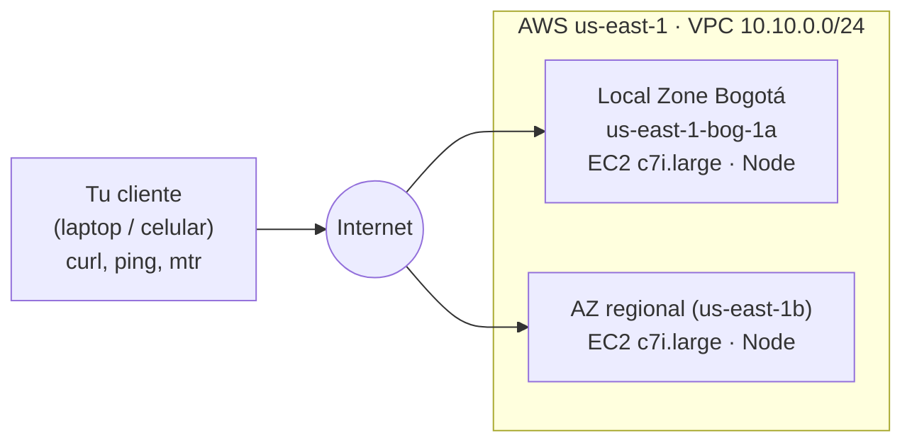

# ¿Vale la pena la Local Zone de AWS en Bogotá para tus usuarios?

[English](README.md)

Una prueba de latencia abierta y reproducible: **AWS Local Zone Bogotá** (`us-east-1-bog-1a`) frente a **us-east-1 (Virginia)**, medida desde *tu* oficina, casa o red móvil. La latencia depende mucho del ISP y de la ruta, así que la única forma de saberlo es medir desde donde están tus usuarios.

Las primeras mediciones se hicieron en Ecuador (ISP-A fibra, ISP-B móvil 5G). Los resultados cambian mucho según el ISP; mira `data/raw/` y el dashboard.

## Qué despliega
- 1 VPC (`10.10.0.0/24`) con dos subredes `/26`: una en la Local Zone y otra en una AZ regional.
- 2 EC2 `c7i.large` (el tipo más barato disponible en la Local Zone de Bogotá; no hay t3), misma app Node, mismo tamaño.
- Endpoints: `/ping` (JSON pequeño) y `/payload` (1 MB). Ambos exigen el header `x-probe-token`; sin él responden 403.

## Arquitectura


## Requisitos
- Una cuenta AWS con la **Local Zone de Bogotá activada** (comandos en el README en inglés).
- Terraform >= 1.5, AWS CLI, `curl`, `bash` (en Windows, WSL). Opcional: `mtr`, `k6`.

## Inicio rápido
```
cd infra/terraform
cp terraform.tfvars.example terraform.tfvars   # define tu aws_profile
terraform init && terraform apply
terraform output                                # IPs
export PROBE_TOKEN=$(terraform output -raw probe_token)
cd ../..
./scripts/measure.sh bogota   <IP_BOGOTA>   <ISP> <fibra|movil> 100 2 &
./scripts/measure.sh virginia <IP_VIRGINIA> <ISP> <fibra|movil> 100 2 &
wait
```
Usa el nombre real de tu ISP en lugar de `<ISP>` (por ejemplo `MYISP`), mantenlo igual en todas las corridas, y usa `movil` para celular o hotspot. Para ver la ruta: `sudo mtr -rwbzc 50 <IP>`.

**Al terminar: `terraform destroy`.** Las instancias se cobran por hora. También puedes apagarlas entre sesiones (las IPs públicas cambian al encenderlas; corre `terraform apply -refresh-only` para actualizar los outputs).

## Dashboard
`dashboard.html` lee los CSV en el navegador (no sube nada). Sirve la carpeta (`python3 -m http.server`) y abre `/dashboard.html`, o arrastra tus CSV a la página. Muestra p50/p95/p99, jitter, pérdida, evolución en el tiempo y comparación por ISP. Para publicarlo, usa GitHub Pages o S3 con CloudFront.

## Buenas prácticas de medición
- Mismo cliente, misma app, mismo tipo de instancia y mismo payload; mide las dos ubicaciones **en paralelo**.
- Varias ventanas (mañana, tarde, noche, horario laboral, fin de semana), al menos 100 muestras por ruta e ISP.
- Registra el ISP y el tipo de red con honestidad (`fibra` / `movil`). Un hotspot móvil suma latencia de radio a ambos destinos.
- El resultado depende del ISP, la ciudad y la hora. No generalices a partir de una sola ventana.

## Limitaciones
- Las Local Zones tienen un catálogo de servicios limitado y dependen de la región padre (IAM, consola).
- El nombre de la Local Zone y su AZ padre pueden variar por cuenta; revisa la tuya (variable `virginia_az`).
- El puerto 80 queda abierto a internet (las IPs móviles cambian) y solo protegido por el token sobre HTTP sin cifrar. Aceptable para una prueba corta; destruye todo al terminar.

## Aporta datos
Abre un PR con tu CSV en `data/community/` (ver su README). Incluye solo datos generados por `scripts/measure.sh`.

## Licencia
MIT
