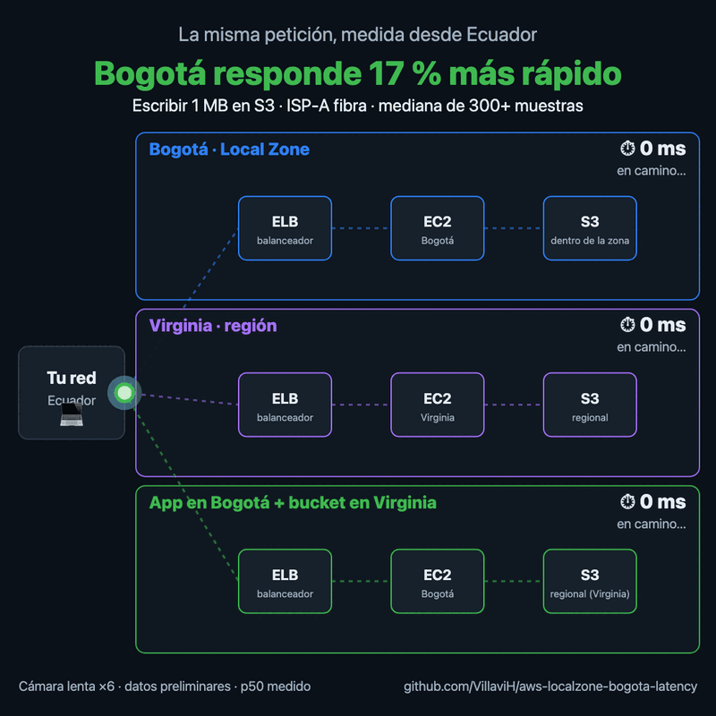
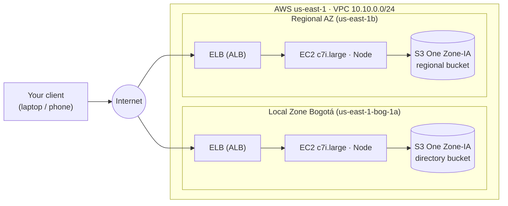

# Is the AWS Local Zone in Bogotá worth it for your users?

[Español](README.es.md)

An open, reproducible latency test: **AWS Local Zone Bogotá** (`us-east-1-bog-1a`) vs **us-east-1 (Virginia)**, measured from *your* office, home or mobile network. Latency depends heavily on the ISP and the route, so the only way to know is to measure from where your users are.



*Same request, slow motion, using the measured medians. Try it live: `demo.html`.*

First measurements were taken in Ecuador (ISP-A fibre, ISP-B mobile 5G). Results differ a lot per ISP; see `data/raw/` and the dashboard.

## What it deploys
The same small app is deployed twice, once in the Bogotá Local Zone and once in a regional AZ (Virginia), using only services AWS lists as available in the Bogotá Local Zone:
- **ELB**: one Application Load Balancer per location.
- **EC2**: one `c7i.large` per location (the cheapest type offered in the zone; no t3). Same Node app.
- **S3 One Zone-IA**: a directory bucket inside the Local Zone, and a regional bucket written with the same storage class in Virginia.
- VPC `10.10.0.0/24` with `/26` subnets. App endpoints: `/ping`, `/payload` (1 MB), `/api/read?obj=small|large` and `/api/write?obj=small|large` (S3), `/health` (no token). Everything else requires the header `x-probe-token`, otherwise 403.

## Architecture


## Requirements
- An AWS account with the **Bogotá Local Zone opted in**:
  ```
  aws ec2 describe-availability-zones --region us-east-1 --all-availability-zones \
    --filters Name=zone-type,Values=local-zone --query "AvailabilityZones[?contains(ZoneName,'bog')]"
  aws ec2 modify-availability-zone-group --region us-east-1 --group-name us-east-1-bog-1 --opt-in-status opted-in
  ```
- Terraform >= 1.5, AWS CLI, `curl`, `bash` (Windows: use WSL). Optional: `mtr`, `k6`.

## Quick start
```
cd infra/terraform
cp terraform.tfvars.example terraform.tfvars   # set your aws_profile
terraform init && terraform apply
terraform output                                # IPs
export PROBE_TOKEN=$(terraform output -raw probe_token)
cd ../..
./scripts/measure.sh bogota   <BOGOTA_IP>   <ISP> <fibra|movil> 100 2 &
./scripts/measure.sh virginia <VIRGINIA_IP> <ISP> <fibra|movil> 100 2 &
wait
```
Use your real ISP name instead of `<ISP>` (e.g. `MYISP`), keep it consistent, and use `movil` for mobile/hotspot. Run `sudo mtr -rwbzc 50 <IP>` to see the route.

**When finished: `terraform destroy`.** Instances and load balancers are billed per hour. You can also stop them between sessions (public IPs change on restart; run `terraform apply -refresh-only` to refresh the outputs).

## Tests
- **Base latency:** TCP connect, TTFB and total time, HTTP and HTTPS (each sample opens a new connection, so TTFB includes the TCP and TLS handshakes): `./scripts/measure.sh bogota <IP> <ISP> <fibra|movil> 100 2 [http|https]`.
- **Full app (ELB + EC2 + S3):** read and write 1 KB and 1 MB objects through the load balancer: `./scripts/measure.sh bogota-alb <ALB_DNS> <ISP> <fibra|movil> 100 2 http "/ping /api/read?obj=small /api/read?obj=large /api/write?obj=large"`. The CSV also records the time the app spent in S3 (`Server-Timing`).
- **App in Bogotá, data in Virginia:** `./scripts/measure_upstream.sh <BOGOTA_IP> <ISP> <fibra|movil>` makes N sequential calls from the Bogotá instance to the Virginia one over the private network (`enable_upstream_test`).
- **App in Bogotá, bucket in the parent region:** the Bogotá instance can also read and write the Virginia bucket (`&target=parent`). Run `EXTRA_QUERY=target=parent ./scripts/measure.sh bogota-parent-alb <BOGOTA_ALB_DNS> <ISP> <fibra|movil> 100 2 http "/api/read?obj=large /api/write?obj=large"`. Compare it with `bogota-alb` to see whether the cost comes from the Local Zone bucket or from the instance location.
- Use the labels `bogota`, `virginia`, `bogota-alb`, `virginia-alb`, `bogota-parent-alb`. The dashboard recognises them.

## Preliminary results
Median total time of the request through the load balancer, in milliseconds (Bogotá / Virginia). Measured from Quito, Ecuador, 100 samples per series and window. ISP-A (fibre) was measured in two windows (Sunday evening and Monday morning, same result); ISP-B (mobile 5G) in one window on Monday morning, plus a `/ping` check on a different day with the same result.

| Test | ISP-A fibre | ISP-B mobile 5G |
|---|---|---|
| `/ping` | 46 / 225 | 327 / 261 |
| Read 1 MB from S3 | 111 / 261 | 385 / 299 |
| Write 1 MB to S3 | 252 / 299 | 505 / 329 |
| Write 1 MB, app in Bogotá + bucket in Virginia | 582 | 874 |
| Time spent in S3 inside the server, write 1 MB | 188 / 54 | 186 / 63 |

- With the app and its data together in Bogotá and a well-routed operator (ISP-A), Bogotá is faster: about 80 % less network time, 57 % less to read 1 MB and 16 % less to write 1 MB.
- With ISP-A the network reaches Bogotá first (about 80 % less on `/ping`). With ISP-B Bogotá is slower in every test (25 % to 54 %).
- S3 inside the Local Zone is slower than regional S3 (writes: about 187 ms against 54 to 63 ms), and it is the same with both operators, so it comes from the service and not from the user's network.
- Moving the app but leaving the data in the parent region makes writes about twice as slow as keeping everything in Virginia, with occasional multi-second stalls inside the S3 call (5 of 300 requests in the ISP-B window).
- Preliminary: one city, two operators, few windows. Do not generalize; measure from your own network.

## Dashboard
`dashboard.html` reads the CSVs in the browser (nothing is uploaded). Serve the folder (`python3 -m http.server`) and open `/dashboard.html`, or drag your CSVs onto the page. It shows p50/p95/p99, jitter, packet loss, time series and per-ISP comparison. To host it, use GitHub Pages or an S3 bucket behind CloudFront.

## Good measurement practice
- Same client, same app, same instance type, same payload size; run both locations **in parallel**.
- Several windows (morning, afternoon, evening, business hours, weekend), at least 100 samples per route and ISP.
- Record ISP and network type honestly (`fibra` / `movil`). Mobile hotspots add radio latency to both targets.
- Results depend on ISP, city and hour. Do not generalize from one window.

## Limitations
- Local Zones have a limited service catalog and depend on the parent region (IAM, console).
- The Local Zone name and parent AZ can differ per account; check yours (`virginia_az` variable).
- The app reaches S3 through its public endpoints (no VPC gateway endpoint), the same way in both locations. A gateway endpoint could change the S3 numbers.
- Port 80 is open to the internet (mobile IPs change) and protected only by the token over plain HTTP. Fine for a short test; destroy afterwards.

## Contribute data
Open a PR adding your CSV to `data/community/` (see its README). Please include only data produced by `scripts/measure.sh`.

## License
MIT
