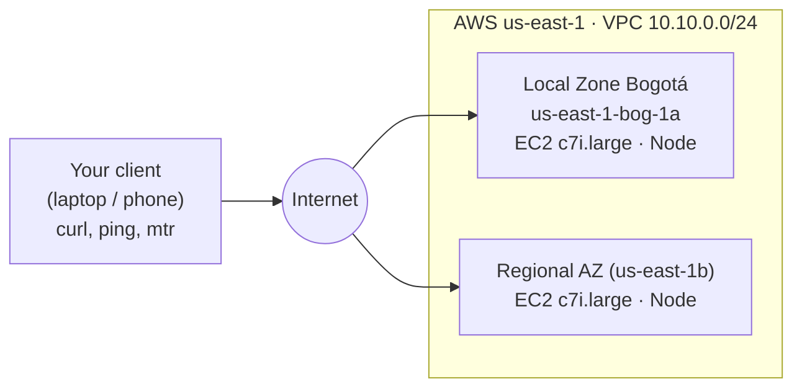

# Is the AWS Local Zone in Bogotá worth it for your users?

[Español](README.es.md)

An open, reproducible latency test: **AWS Local Zone Bogotá** (`us-east-1-bog-1a`) vs **us-east-1 (Virginia)**, measured from *your* office, home or mobile network. Latency depends heavily on the ISP and the route, so the only way to know is to measure from where your users are.

First measurements were taken in Ecuador (ISP-A fibre, ISP-B mobile 5G). Results differ a lot per ISP; see `data/raw/` and the dashboard.

## What it deploys
- 1 VPC (`10.10.0.0/24`) with two `/26` subnets: one in the Local Zone, one in a regional AZ.
- 2 EC2 `c7i.large` (the cheapest type offered in the Bogotá Local Zone; no t3), same Node app, same size.
- App endpoints: `/ping` (tiny JSON) and `/payload` (1 MB). Both require the header `x-probe-token`, otherwise 403.

## Architecture


## Requirements
- An AWS account with the **Bogotá Local Zone opted in**:
  ```
  aws ec2 describe-availability-zones --region us-east-1 --all-availability-zones \
    --filters Name=zone-type,Values=local-zone --query "AvailabilityZones[?contains(ZoneName,'bog')]"
  aws ec2 modify-availability-zone-group --region us-east-1 --group-name us-east-1-bog-1 --opt-in-status opted-in
  ```
- Terraform >= 1.5, AWS CLI, `curl`, `bash` (Windows: use WSL). Optional: `mtr`, `k6`.

## Quick start
```
cd infra/terraform
cp terraform.tfvars.example terraform.tfvars   # set your aws_profile
terraform init && terraform apply
terraform output                                # IPs
export PROBE_TOKEN=$(terraform output -raw probe_token)
cd ../..
./scripts/measure.sh bogota   <BOGOTA_IP>   <ISP> <fibra|movil> 100 2 &
./scripts/measure.sh virginia <VIRGINIA_IP> <ISP> <fibra|movil> 100 2 &
wait
```
Use your real ISP name instead of `<ISP>` (e.g. `MYISP`), keep it consistent, and use `movil` for mobile/hotspot. Run `sudo mtr -rwbzc 50 <IP>` to see the route.

**When finished: `terraform destroy`.** Instances are billed per hour. You can also stop them between sessions (public IPs change on restart; run `terraform apply -refresh-only` to refresh the outputs).

## Extra tests (enabled by default)
- **HTTPS:** both EC2 also serve HTTPS on 443 with a self-signed certificate (no domain needed). Measure with the 7th argument: `./scripts/measure.sh bogota <IP> <ISP> <fibra|movil> 100 2 https`. Each sample is a new connection, so TTFB includes TCP and TLS handshakes.
- **CloudFront vs Local Zone:** a CloudFront distribution sits in front of the Virginia instance (`terraform output cloudfront_domain`). Measure cacheable paths: `./scripts/measure.sh cloudfront <DOMAIN> <ISP> <fibra|movil> 100 2 https "/cached /cached-payload"`. The CSV records the edge location (`pop`) and cache status. Disable with `enable_cloudfront = false`.
- **App in Bogotá, database in Virginia:** `/upstream?n=10` on the Bogotá instance makes N sequential calls to the Virginia instance over the private network. Run `./scripts/measure_upstream.sh <BOGOTA_IP> <ISP> <fibra|movil>`. The dashboard shows how many queries per request it takes for Virginia to win again. Disable with `enable_upstream_test = false`.

## Dashboard
`dashboard.html` reads the CSVs in the browser (nothing is uploaded). Serve the folder (`python3 -m http.server`) and open `/dashboard.html`, or drag your CSVs onto the page. It shows p50/p95/p99, jitter, packet loss, time series and per-ISP comparison. To host it, use GitHub Pages or an S3 bucket behind CloudFront.

## Good measurement practice
- Same client, same app, same instance type, same payload size; run both locations **in parallel**.
- Several windows (morning, afternoon, evening, business hours, weekend), at least 100 samples per route and ISP.
- Record ISP and network type honestly (`fibra` / `movil`). Mobile hotspots add radio latency to both targets.
- Results depend on ISP, city and hour. Do not generalize from one window.

## Limitations
- Local Zones have a limited service catalog and depend on the parent region (IAM, console).
- The Local Zone name and parent AZ can differ per account; check yours (`virginia_az` variable).
- Port 80 is open to the internet (mobile IPs change) and protected only by the token over plain HTTP. Fine for a short test; destroy afterwards.

## Contribute data
Open a PR adding your CSV to `data/community/` (see its README). Please include only data produced by `scripts/measure.sh`.

## License
MIT
